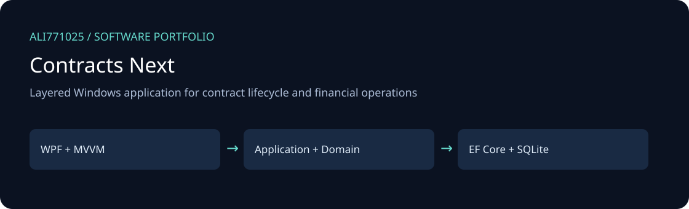
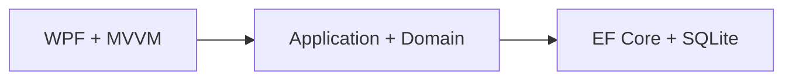

# Contracts Next

<!-- project-contact:start -->
**Work with Yosof Omrani:** [Email a project inquiry](mailto:aliomrani916@gmail.com) · **aliomrani916@gmail.com** · [Services & contact](https://ali771025.github.io/software-portfolio/en/contact/) · [Portfolio walkthrough](https://ali771025.github.io/software-portfolio/en/work/contracts-next/)
<!-- project-contact:end -->

Layered Windows application for contract lifecycle and financial operations

[راهنمای فارسی](docs/README.fa.md) · [Discuss a project](https://github.com/Ali771025)

## What this project demonstrates

- Domain and application layers for contracts, parties, payments, receipts and guarantees.
- Persian RTL desktop views, reporting and dashboard integration.
- Authorization abstractions, audit logging, migration tools and persistence migrations.

**Technology:** CSharp, WPF, DotNet8, EF-Core, SQLite, MVVM.

## Architecture

The illustration describes source boundaries; it is not a product screenshot.

## Explore and set up

Use Windows, the .NET 8 SDK specified in `global.json` and the WPF desktop workload. Restore the projects in `ContractsNext.Source.slnf`; review `src/Contracts.Desktop` and create local `appsettings.json` from the example. Existing migration tooling is under `tools/`. Access migration also needs the matching ACE provider and an independently supplied source database.

## Portfolio scope and limitations

No actual contracts, Access/SQLite databases, reconciliation exports or private delivery artifacts are supplied. Tests and deployment packages are omitted. The original solution still lists omitted tests; use the source filter or individual project paths. Review local data paths and dashboard resource requirements before first execution.

This edition contains selected source only. Private data, customer documents, databases, deployment secrets, old Git history, generated outputs, dependency caches and model weights are excluded. No new tests, builds, or live integrations were executed for this publication; runtime behavior and production readiness are not newly validated.

## Work with me

Need a similar workflow, an integration, or modernization of an existing application? [Contact Ali on GitHub](https://github.com/Ali771025) with your business process, target platform and delivery constraints. This source demonstrates relevant implementation areas; any proposed delivery needs its own agreed scope and acceptance criteria.

## Dependencies and attribution

Existing source headers and bundled notices remain applicable. Third-party components retain their own licenses; restore dependencies from the manifests. No additional license grant is implied by this portfolio publication.
